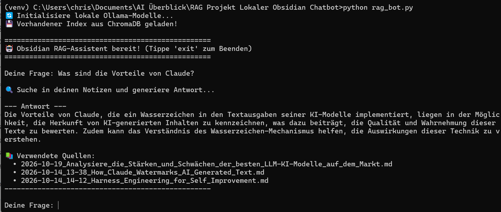

# 💬 Lokaler RAG-Chatbot für Obsidian-Notizen

> Ein RAG-Chatbot (Retrieval-Augmented Generation), der Fragen zum eigenen Obsidian-Wissensarchiv beantwortet und dabei vollständig lokal ohne Cloud-Dienste läuft.

---

## Rolle & Entwicklungsansatz

* **Rolle:** Christoph Bauer, Business Analyst: Anforderungen, Aufbau der RAG-Pipeline (Chunking, Retrieval, Quellenangabe), Datenschutzkonzept und Test.
* **Umsetzung:** Den Python-Code habe ich mit KI-Coding-Assistenten erstellt und anschließend getestet und angepasst.

---

## Ausgangslage und Lösung

* **Ziel:** Ein lokales Obsidian-Archiv (über 40 Markdown-Notizen) inhaltlich durchsuchen, ohne Notizen an Cloud-Dienste wie OpenAI oder Anthropic zu übergeben.
* **Lösung:** Eine lokale RAG-Pipeline in Python. Sie indexiert den Vault, speichert die Notizen als Vektoren und beantwortet Fragen mit Angabe der Quelldatei.
* **Ergebnis:** Ein offline nutzbarer Chatbot mit lokalen Ollama-Modellen und einem dauerhaft gespeicherten Vektorindex (ChromaDB).

---

## Tech Stack

* **Framework:** LlamaIndex
* **Modelle (lokal über Ollama):** `nomic-embed-text` für Embeddings, `qwen2.5:3b` für die Antworten
* **Vektordatenbank:** ChromaDB, gespeichert im Ordner `./chroma_db`
* **Umgebung:** Python 3.11 in einer virtuellen Umgebung (`venv`) unter Windows

---

## Ablauf der Pipeline

1. **Einlesen:** Markdown-Notizen aus dem Vault per `SimpleDirectoryReader`, inklusive Dateipfad als Metadatum.
2. **Aufteilen:** `SentenceSplitter` mit 512 Token pro Abschnitt und 50 Token Überlappung, damit Zusammenhänge an Abschnittsgrenzen erhalten bleiben.
3. **Indexieren:** Embeddings erzeugen und in ChromaDB speichern. Bei späteren Starts wird der vorhandene Index geladen statt neu berechnet.
4. **Antworten:** Zu jeder Frage werden die 3 passendsten Abschnitte (`similarity_top_k=3`) gesucht, dem LLM als Kontext übergeben und mit Quelldatei ausgegeben.

---

## Ausführung



---

## Learnings

1. **Python-Version wählen:** ChromaDB und ihre Abhängigkeiten (`hnswlib`, `numpy`) ließen sich unter der neuesten Python-Version nicht bauen (`metadata-generation-failed`). Mit Python 3.11 lief die Installation stabil.
2. **Paketnamen prüfen:** LlamaIndex hat Integrationen in eigene Pakete ausgelagert, z. B. `llama-index-vector-stores-chroma`.
3. **Nachvollziehbarkeit:** Die Angabe der Quelldatei zu jeder Antwort macht prüfbar, worauf sich das Modell stützt.

---

## Einrichtung

1. Ollama installieren und die Modelle laden: `ollama pull nomic-embed-text` und `ollama pull qwen2.5:3b`
2. Abhängigkeiten installieren: `pip install -r requirements.txt`
3. In `Scripts/rag_bot.py` den Pfad zum eigenen Vault in `OBSIDIAN_VAULT_PATH` eintragen.

---

## Repository-Struktur

```text
├── Scripts/
│   └── rag_bot.py                         # Interaktiver RAG-Chatbot
├── Pictures/
│   └── rag-terminal-execution-output.png
├── requirements.txt                       # LlamaIndex, ChromaDB, Ollama-Anbindung
└── README.md
```

*Hinweis:* Der Vektorindex `chroma_db/` wird beim ersten Start lokal erzeugt und ist nicht Teil des Repositorys.
