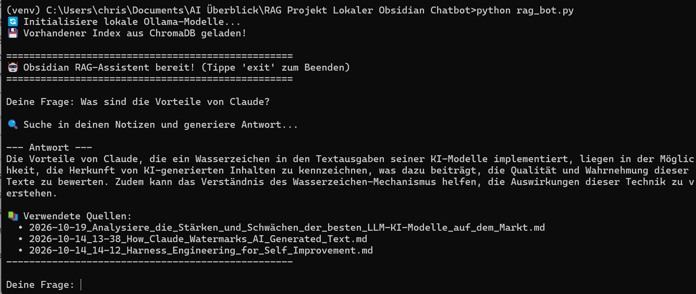

# 💬 Lokaler Obsidian-RAG-Chatbot (100% Privacy-First Wissensassistent)

> **Entwicklung eines lokalen RAG-Chatbots (Retrieval-Augmented Generation) zur datenschutzkonformen Abfrage des eigenen Obsidian-Wissensarchivs ohne Cloud-Anbindung.**

---

## 🚀 Executive Summary

Das System indiziert eigenständig den lokalen Obsidian-Vault, konvertiert Markdown-Notizen in semantische Vektoren und ermöglicht es, präzise Fragen an das eigene Wissensarchiv zu stellen – absolut datenschutzkonform, ohne Cloud-Anbindung und mit exakter Quellenangabe (Dateinamen).

---

## 🖼️ Terminal Execution & Live-Ausführung



---

## 🛠️ Tech Stack & Architecture

- **Framework:** LlamaIndex (spezialisiert auf Data-Centric LLM-Applikationen und sauberes Markdown-Parsing).
- **Embedding & LLM Layer:** Ollama (lokale Ausführung von `nomic-embed-text` für Vektoren und `qwen2.5:3b` für die Antwortgenerierung).
- **Vector Database:** ChromaDB (lokale, persistente In-Memory/Dateisystem-Datenbank über `./chroma_db`).
- **Laufzeitumgebung:** Python 3.11 in einer isolierten virtuellen Umgebung (`venv`) auf Windows[cite: 3].

---

## ⚙️ Umsetzung & Pipeline-Design

1. **Ingestion & Parsing:** Einlesen von 40+ Markdown-Notizen aus dem Obsidian-Vault via `SimpleDirectoryReader` inklusive automatischer Metadaten-Zuordnung (`file_path`).
2. **Chunking & Transformation:** Aufteilung der Notizen über den `SentenceSplitter` (Chunk-Größe: 512 Token, Overlap: 50 Token), um semantische Brüche an Dokumentgrenzen zu verhindern.
3. **Persistente Indexierung:** Generierung von Embeddings und Speicherung in der lokalen ChromaDB. Dank persistenter Ablage werden Folgestarts in Bruchteilen einer Sekunde geladen[cite: 3].
4. **Retrieval & Generation (Query Engine):** Bei einer Anfrage werden die 3 relevantesten Text-Chunks (`similarity_top_k=3`) ermittelt, dem lokalen LLM als Kontext übergeben und mit Verweis auf die Quelldatei ausgegeben.

---

## 💡 Key Learnings & Architecture Insights

- **Python-Versionen & C++ Dependencies:** Moderne AI-Bibliotheken (wie ChromaDB, `hnswlib` und `numpy`) setzen auf tiefe Kompilierungen. Die Verwendung von Python 3.11 anstelle brandneuer Python-Releases verhindert Build-Fehler (`metadata-generation-failed`) und garantiert Stabilität.
- **Modulare Paketstruktur:** LlamaIndex hat Vektor-Store-Integrationen ausgelagert. Korrekte Paketbezeichnungen (z. B. `llama-index-vector-stores-chroma`) sind essenziell für fehlerfreie Importe.
- **Ground Truth & Traceability:** Die Verknüpfung von `node.metadata` mit dem Dateinamen stellt sicher, dass generierte Antworten stets überprüfbar und frei von Halluzinationen über das eigene Notizarchiv sind.

---

## 📂 Repository-Struktur

```text
├── 🐍 rag_bot.py                  # Hauptskript für den interaktiven RAG-Chatbot[cite: 3]
├── 📁 chroma_db/                  # Persistenter lokaler Vektorspeicher-Index[cite: 3]
├── 📄 requirements.txt            # Python-Abhängigkeiten (LlamaIndex, ChromaDB, Ollama etc.)
└── 🖼️ rag-terminal-execution-output.png # Terminal-Ausführungs-Asset[cite: 3]
